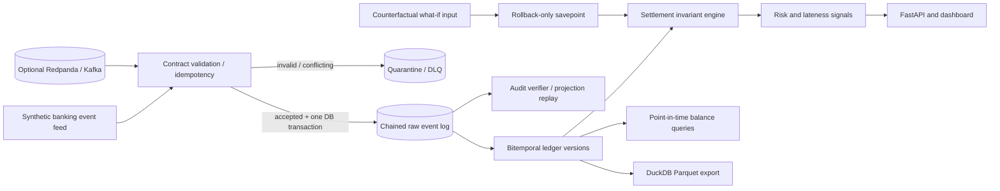

<div align="center">

# ◈ CAUSALMESH
### *Temporal Truth Engine for Financial Events*

**A verifiable, failure-aware, bitemporal settlement intelligence system.**

`Python 3.11+` · `FastAPI` · `SQLite WAL` · `Kafka/Redpanda (optional)` · `DuckDB/Parquet (optional)` · `pytest` · `Docker` · `Prometheus`

> **Portfolio engineering research — all transactions and customer identifiers are synthetic.**

</div>

---

## Why this exists

A successful pipeline can still produce incorrect business truth. Financial data systems break when events arrive out of order, are replayed, are corrected retroactively, or when two sides of a settlement disagree. A conventional ETL dashboard often reports that the job succeeded while the reported balance is wrong.

**CausalMesh makes the failure observable and answerable.** For any financial event, it can answer:

1. **What happened?** The raw accepted message and its integrity-chain position.
2. **What did we believe at the time?** An independent *system/knowledge-time* cutoff.
3. **What was financially effective then?** A separate *business-time* cutoff.
4. **Why does a settlement fail?** Explainable mirrored-leg invariant checks.
5. **What would a correction change?** A zero-commit, rollback-only counterfactual simulation.
6. **Can we reproduce the answer?** Full deterministic projection replay from the accepted log.

## 60-second demo

```bash
# Python 3.11+
python -m venv .venv
source .venv/bin/activate           # Windows: .venv\Scripts\activate
pip install -e '.[dev]'

causalmesh demo --transfers 250     # creates a local synthetic data set
causalmesh audit                   # verifies the log's SHA-256 chain
uvicorn causalmesh.api:app --host 127.0.0.1 --port 8000
```

Open **http://127.0.0.1:8000/dashboard**, then explore the **http://127.0.0.1:8000/docs** OpenAPI console. The demo creates intentional replays, broken settlements, late arrivals, duplicate messages, quarantine events, and later revisions that repair historical mismatches.

To run everything with Docker (dashboard API only):

```bash
docker compose up --build -d api
docker compose exec api python -m causalmesh demo --transfers 250
# open http://127.0.0.1:8000/dashboard
```

## Architecture



The **local database commit** atomically stores the raw event and the derived projection. Unique `event_id` values provide idempotent database effects if the same message is delivered repeatedly. **This does not claim globally exactly-once Kafka delivery.** Kafka ingestion is optional and commits offsets after processing; a crash may redeliver a message, which is then deduplicated.

## The important features

| Capability | What it actually does | Proof / demonstration |
|---|---|---|
| Bitemporal ledger | Preserves every revision with separate `effective_at`, `sys_from`, `sys_to` | `/api/as-of/{account}` |
| Financial invariant engine | Checks mirrored debit/credit legs, matching minor-unit amount, currency and counterparties | `/api/transfers` |
| Idempotent ingestion | Rejects altered reuses of an ID; returns `duplicate` for identical replays | `tests/test_engine.py` |
| Cryptographic event log | SHA-256 chain with canonical JSON and timestamps | `causalmesh audit` |
| Deterministic rebuild | Recomputes projections and alerts from the same ordered log without changing it | `causalmesh replay` |
| What-if isolation | Previews a proposed leg/revision under a SQLite savepoint, then rolls back | `POST /api/simulate` |
| Incident evidence | Exposes mismatch / high-value / late-arrival alerts with source IDs | `/api/alerts` |
| Lineage narrative | Links transfer projection to actual accepted event IDs/hashes | `/api/lineage/{transfer_id}` |
| Kafka adapter | Optional Kafka-compatible producer/consumer | `causalmesh produce-kafka` |
| Parquet gold snapshot | Optional DuckDB export of latest valid ledger rows | `causalmesh export` |
| Ops instrumentation | Health endpoint, Prometheus exposition, quarantine counters, OpenAPI | `/healthz`, `/metrics`, `/docs` |

### Data contract example

```json
{
  "event_id": "evt-000001-debit-r1",
  "leg_id": "leg-000001-debit",
  "transfer_id": "TRX-000001",
  "revision": 1,
  "account_id": "ACC-0101",
  "counterparty_id": "ACC-0201",
  "side": "DEBIT",
  "currency": "USD",
  "amount_minor": 120000,
  "effective_at": "2026-11-13T10:00:00+00:00",
  "schema_version": 1
}
```

Money is represented in **integer minor units**, not floats. A balanced transfer has a `DEBIT` and matching `CREDIT` with mirrored account/counterparty values. Revision `2` of an existing leg may change the amount or effective time, but cannot change its identity or transfer.

### The bitemporal query — the core differentiator

A credit of 1001 cents was believed at `10:05`. At `10:15`, revision 2 corrected it to 1000 cents, effective at the same business instant. These are **two valid answers to different knowledge-time questions**, and the old record must remain queryable.

```bash
curl 'http://127.0.0.1:8000/api/as-of/ACC-0203?business_at=2026-11-13T10:30:00%2B00:00&knowledge_at=2026-11-13T10:10:00%2B00:00'
```

The query returns the account's balance *as of business time* using only revisions *known by knowledge time*. See `tests/test_engine.py::test_correction_maintains_bitemporal_truth` for a precise reproducible assertion independent of any demo clock.

## Deep-dive workflows

**Audit chain / replay**

```bash
causalmesh audit
causalmesh replay
causalmesh stats
```

**Kafka-compatible dev stream**

```bash
pip install -e '.[stream]'
docker compose --profile stream up -d redpanda
causalmesh produce-kafka --transfers 200
causalmesh consume-kafka       # separate terminal, long-running consumer
```

`causalmesh consume-kafka` defaults to `localhost:19092` and consumes topic `causalmesh.ledger.v1`. Single-broker Docker setup is **development only**. Kafka and Docker paths are included but have not been integration-tested in this delivery environment.

**Parquet gold materialization**

```bash
pip install -e '.[lake]'
causalmesh export --output data/gold
```

`current_ledger.parquet` contains the active version of each leg. The historical versions remain in SQLite. This is a demonstration snapshot, not a multi-writer transactional lakehouse.

**Fault-injection and test suite**

```bash
pytest -q
python scripts/benchmark.py --transfers 1000
```

## Visual control plane

The dashboard is served directly by FastAPI with no third-party frontend build chain. It displays settlement state, risk counts, a verifiable audit hash, transfer diagnostics, signal evidence, and an interactive correction sandbox. It refreshes automatically against the local API.

## Productionization path

The current implementation is a **functional local reference architecture**, not a claim of production bank readiness. Senior-engineering next steps would include: Kafka schema registry + compatibility contracts; partition-aware offset/inbox atomicity; Postgres/Delta or Iceberg-backed horizontal processing; external object-storage log anchoring; OAuth2/RBAC; PII tokenization; data-retention policies; OpenTelemetry traces; Prometheus scraping/Grafana; load/soak tests; CDC connectors; chaos across process and network failures.

See `docs/ARCHITECTURE.md`, `docs/DECISIONS.md`, `docs/RUNBOOK.md`, and `docs/SECURITY.md` for implementation tradeoffs, failure modes, and safe operation.

### Test and benchmark honesty

The portable core and HTTP API are covered by automated tests. No AWS/Snowflake/Databricks infrastructure, cloud security, bank integration, multi-broker consensus, or production scale is claimed. Throughput depends on hardware, SQLite journal settings and scenario; benchmark output must be recorded from your environment rather than invented.

## Portfolio framing

> **CausalMesh** — designed and implemented a synthetic financial settlement reliability engine with bitemporal revisions, hash-chain audit proofs, idempotent ingestion, mismatch detection, replay-safe projections, API-based lineage and rollback-only counterfactual simulation. Built a dashboard, developer CLI, automated tests, optional Kafka adapter and Parquet export.

**Status:** portfolio demonstration / locally tested core. **Data:** entirely synthetic. **License:** MIT.

---

## Cloud Lakehouse v2 — AWS + Databricks + PySpark

The original API and SQLite ledger remain independently runnable. An **additional,
real PySpark path** now transforms verified accepted financial events into bitemporal
Silver and reconciled Gold with contract quarantine and retry-safe event IDs.

| Layer | Implementation | Execution status |
|---|---|---|
| Accepted source | SHA-256 audited ledger export to JSONL | Local bridge tested |
| PySpark | Schema contract, dedupe, revision guards, `as_of`, settlement marts | Spark CI test workflow |
| Delta Lake | Bronze MERGE with `foreachBatch` checkpoints, Gold snapshots | Databricks runtime required |
| Databricks | Declarative Automation Bundle, two wheel Jobs, Unity Catalog registration | Config only until workspace access |
| AWS | Terraform S3 SSE-S3 + TLS, versioning, public block, IAM role/external ID, Glue, CloudWatch | No `apply` performed |
| Kafka | Optional Redpanda producer and Spark Kafka source | Optional; not live integration-tested |
| Airflow | Run-now trigger for existing Databricks job | Requires Airflow provider/connection |
| Snowflake | SQL serving model and external-stage example | Requires stage/integration and Parquet export |
| CI/CD | Java 17 + PySpark 4 tests on GitHub Actions | Verifiable in repository Actions |

### Execute local PySpark batch

```bash
pip install -e '.[dev,spark]'
causalmesh demo --transfers 50
python -m causalmesh.cloud.export_cli --db data/causalmesh.db --output data/landing/part-000.jsonl
python -m causalmesh.cloud.job --input data/landing --output data/lake --format parquet
```

**Required:** Python 3.11+, Java 17+, and a working PySpark install. The output is a
portable Parquet batch snapshot; managed Delta Lake and Unity Catalog are separate
Databricks-only paths. No AWS or Databricks deployment is implied by the repository.

Read the detailed **[Cloud architecture and setup](docs/CLOUD_LAKEHOUSE.md)** and
**[senior-level interview walkthrough](docs/CLOUD_INTERVIEW.md)**. All data are synthetic.
