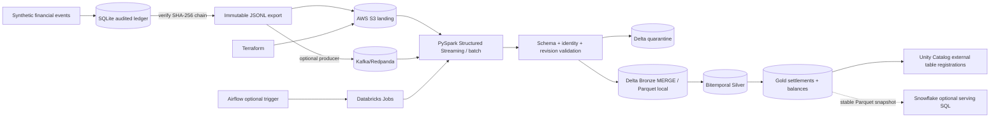

# CausalMesh Cloud Lakehouse v2 — implementation and boundaries

This extends the existing local bitemporal ledger engine; it does **not** replace its API,
correctness tests, or audit chain. All financial records are generated synthetically.

## Architecture



**Why a separate local and cloud engine?** The SQLite ledger provides one-writer atomic
acceptance, audit hashes, and counterfactual previews. Spark processes *accepted* immutable
rows into scalable analytical projections and reconciled marts; it is not the transactional
system of record. A hash from the source is carried as a lineage field, not recalculated by
Spark or presented as an independently verified cloud-wide audit chain.

## Local end-to-end (actual Spark transformations, not pseudocode)

Requirements: Python 3.11+; Java 17+; PySpark 4.x (installed separately); enough RAM
for a local Spark JVM. The minimal API-only core still works without Java or PySpark.

```bash
pip install -e '.[dev,spark]'
# core synthetic input, immutable accepted-event output
causalmesh --db data/causalmesh.db demo --transfers 50
python -m causalmesh.cloud.export_cli --db data/causalmesh.db --output data/landing/part-000.jsonl
# distributed DataFrame transforms; portable Parquet materialization
python -m causalmesh.cloud.job --input data/landing --output data/lake --format parquet
pytest -q tests/test_cloud_spark.py
```

Outputs: `data/lake/{bronze,silver,gold_transfers,gold_balances,quarantine}`.
`gold_transfers` reports SETTLED/PENDING/MISMATCH and `difference_minor`.
`gold_balances` aggregates signed money in integer minor units by account and currency.
`silver` preserves each revision's valid-time (`effective_at`) and system-time
(`sys_from`, `sys_to`) intervals. To answer a historical as-of question programmatically:
`causalmesh.cloud.pipeline.as_of(silver_df, business_at, knowledge_at)`.

**Important semantics:** The local Parquet batch uses destructive, deterministic snapshot
`overwrite` at *each separate dataset*. Do not run multiple writers. Its outputs are **not**
multi-table atomic and should not be exposed to concurrent production readers.

## AWS infrastructure

Review `infra/aws` before running any `terraform apply`. It creates:

- S3 lake bucket: public access blocked, versioning enabled, SSE-S3 default encryption,
  and explicit denial of HTTP transport;
- AWS IAM role scoped to landing, Delta, and checkpoint prefixes with trust tied to
  a specific AWS principal *and* STS ExternalId;
- Glue database for potential interoperability and CloudWatch log group for use by
  separately configured jobs. They are **not wired to Databricks or Snowflake** automatically.

```bash
cd infra/aws
cp terraform.tfvars.example terraform.tfvars
# Edit bucket/principal; supply secret only via secret manager or environment:
export TF_VAR_databricks_external_id='ACTUAL-EXTERNAL-ID'
terraform init
terraform validate
terraform plan
# Review the plan carefully before choosing terraform apply
```

Production accounts also require AWS account-specific lifecycle policy, IAM boundaries,
KMS keys if required, audit log delivery, bucket replication/retention, private network
routes, budget alarms, and remote encrypted Terraform state with locking. None are claimed
as implemented.

## Databricks / Delta / Unity Catalog deployment

`databricks.yml` is a declarative bundle containing a **batch** job and **continuous
microbatch** job; execution requires a Databricks workspace, cluster permissions, Delta
runtime, and network access to S3. UC storage credentials, external locations, and the
catalog/schema must already exist and be administered with least privilege.

Databricks renamed Asset Bundles to **Declarative Automation Bundles**; the CLI still uses
`databricks bundle ...` commands. Specify your workspace host/auth out of band. Set the
bundle variables in a private target override (not source code), or pass vars at deploy:

```bash
python -m pip install build
# after installing/authenticating the Databricks CLI:
databricks bundle validate -t dev \
  --var 'raw_uri=s3://YOUR_BUCKET/landing/,lake_uri=s3://YOUR_BUCKET/delta/,checkpoint_uri=s3://YOUR_BUCKET/checkpoints/,catalog=YOUR_CATALOG,schema=YOUR_SCHEMA'
databricks bundle deploy -t dev \
  --var 'raw_uri=s3://YOUR_BUCKET/landing/,lake_uri=s3://YOUR_BUCKET/delta/,checkpoint_uri=s3://YOUR_BUCKET/checkpoints/,catalog=YOUR_CATALOG,schema=YOUR_SCHEMA'
databricks bundle run causalmesh_settlement_batch -t dev
```

The batch task uses a built wheel and Spark to write Delta tables under the governed
S3 external location, then registers **five actual external Delta tables** under
`catalog.schema.causalmesh_{bronze,silver,gold_transfers,gold_balances,quarantine}`.
No external UC setup is fabricated; storage credentials/external locations must be
configured by an authorized workspace administrator. A new target could have an
incompatible runtime/worker family; validate against your workspace.

### Streaming semantics

Structured Streaming supports landing JSON files **or** Kafka source. Each microbatch:
validates the payload, rejects conflicting/revised identities, **MERGEs Bronze by event_id**,
then recomputes bitemporal Silver and the two Gold marts from full Bronze. Invalid and
conflicting rows merge into Quarantine by stable key. Durable checkpointing handles replay
and source offsets; it does not provide global exactly-once semantics for every downstream
side effect. Delta transactions apply per table, not across all tables. Source event IDs
must be globally stable. Concurrent writers are disallowed.

Example Databricks file-source stream uses the second bundle job. For Kafka development
using the included local Redpanda broker, first export the **accepted** events, publish
with `scripts/publish_accepted_kafka.py`, then run a Spark runtime with the compatible
Kafka connector configured:

```bash
python scripts/publish_accepted_kafka.py \
  --input data/landing/part-000.jsonl --bootstrap localhost:19092
python -m causalmesh.cloud.job \
  --mode stream --format delta --source kafka \
  --input unused-for-kafka --output s3://YOUR_BUCKET/delta/ \
  --checkpoint s3://YOUR_BUCKET/checkpoints/kafka-consumer/ \
  --kafka-bootstrap YOUR_BOOTSTRAP --kafka-topic causalmesh.accepted.v1
```

Kafka examples are for **development**. Production Kafka requires SASL/TLS authentication,
connector artifacts, ACLs and secrets; they are not provisioned by this repository.
File-stream checkpoints and Kafka-stream checkpoints must **never be shared**. In batch,
Silver/Gold are full snapshots. Recomputing all Bronze per microbatch is deliberate for
pedagogical clarity and will not scale to unbounded history. Next step: partition-pruned
incremental reconciliation and Delta Change Data Feed / change tracking.

## Airflow and Snowflake

- `airflow/dags/causalmesh_lakehouse.py` triggers a **previously deployed** Databricks
  batch job by `CAUSALMESH_DATABRICKS_JOB_ID` using an authenticated Airflow connection.
  Missing configuration fails a task; Airflow never provisions cloud jobs itself.
- `snowflake/settlement_analytics.sql` provides the Gold serving table, an optional
  external-stage COPY example, and reporting view. It requires an authorized S3 storage
  integration and a **stable Parquet export**. It cannot directly query arbitrary Delta
  transaction logs as Parquet files. COPY is a reference example: for periodic refreshes,
  load into a staging table and MERGE by transfer_id for idempotency (see `snowflake/idempotent_refresh.sql`).

## Failures, operational risks, and security

1. Invalid monetary/identity/revision events are quarantined; conflicting event_id reuse
   is not overwritten. Exact delivery retries are idempotent at Bronze.
2. The older accepted event is the truth when the same event_id later arrives with a
   different payload; only an explicit higher revision may amend a ledger leg.
3. A crash between separate Gold writes can temporarily expose inconsistent tables;
   consumers needing a consistent run must implement a published `run_id` manifest and
   read all outputs at one committed generation.
4. A cluster restart with the same checkpoint should resume source progress, but Delta
   table versions can be overwritten across microbatches; plan retention and recovery.
5. This repository contains **no AWS account, Databricks workspace, Snowflake warehouse,
   cloud credentials, billable resource deployment, or verified cloud integration**.

## What is actually tested

- Core ledger: existing 32-test suite (locally runnable).
- Local cloud bridge/config: export, tamper rejection, input guardrails, UC identifier
  validation (no JVM required).
- Actual Spark tests (in GitHub Actions with Java 17 and PySpark 4): bitemporal correction,
  idempotent dedup/collision rejection, revision integrity, settlement reconciliation,
  and Parquet end-to-end IO.
- Cloud components (Databricks Jobs, Delta external locations, AWS, live Kafka, Airflow,
  Snowflake) are examples requiring your accounts and environment before claiming they ran.

See `docs/RUNBOOK.md`, `docs/SECURITY.md`, and `docs/DECISIONS.md` for the local core's
original limitations. AWS infrastructure can incur charges if you run `terraform apply`.
